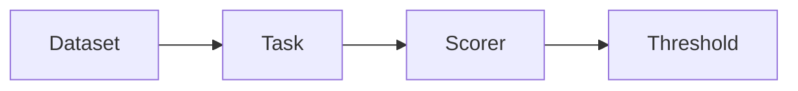
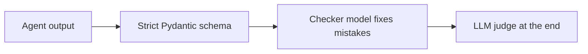
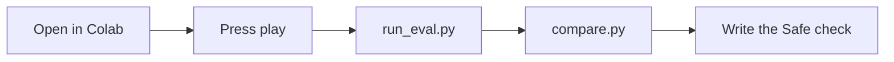
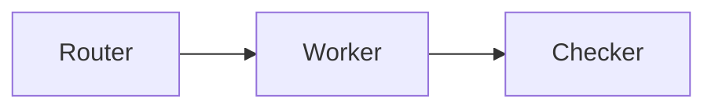

<!-- GENERATED FILE. Edit the live deck, then rerun scripts/export-slidev.mts. -->
<div class="kicker">Week 6 · Builders Track</div>

# Is Your AI Actually Right?

Test it before you trust it. Evals, guardrails & system architecture.

- **Maria**: 3percentclub
- **Farad**: Healthcare tech, builder of Plantiopolis, runs evals on a local DGX Spark

<!--
Welcome to Week 6, the last class before Build Weekend. Tonight we learn to answer one question honestly: is my AI actually right, or did I get lucky once? I'm co-teaching with Farad.

- Farad joins on Zoom. Date locked: Tue Oct 20, 6–8pm ET (he asked about starting before 6). Confirm room before sending this deck.
-->

---
layout: default
---

<div class="kicker">Do Now · 5 min · From memory, no notes</div>

# What Do You Still Remember?

- Your RAG bot gives an answer. How could you tell if it made something up?
- Name one thing you strip or label before text reaches the model.
- “A keep-out sign is not a lock.” So what is the lock?
- Same prompt, same model, run twice. Same answer? Why or why not?
- Your Week 5 lock tests passed once. Would you bet your hackathon demo on that?

<div class="callout">

Guesses count. New tonight? Pair up and guess. On Zoom? Answer in the chat.

</div>

<!--
This is on screen as people arrive, so start writing right away. Answer from memory, no notes and no scrolling back. It's not graded. If you're new tonight, team up with someone and guess, because guessing still counts.

- Put this slide up before 6:00. Don't do a spoken recap first: answering from memory IS the recap.

- Walk the room (and watch the Zoom chat) for Q1 and Q3. Those two are what tonight builds on most.

- If most people miss Q3 (locks), take 2 min on it: a prompt instruction is a sign, code is the lock. The Safe evals tonight won't make sense without it.

- New faces: builders-slides.vercel.app/resources has the catch-up recaps.
-->

---
layout: default
---

<div class="kicker">Check Your Answers · Weeks 1–5</div>

# Every Answer Was a Check

- **1 · Week 4**: Check each claim against the passages you retrieved. If no passage backs it up, the bot made it up.
- **2 · Week 5**: Swap PII for placeholders, and mark outside text as untrusted.
- **3 · Week 5**: Code: allowlists, permissions, and approval for risky actions. A prompt can be ignored. Code can't.
- **4 · Week 2**: Not always. Models sample their output, so answers can change from run to run.

<div class="callout">

Q5: one passing run is luck, not proof. Tonight we learn how to get proof.

</div>

<!--
Show me Q1 on Zoom: type a 1 if you got it. Each answer you just gave is a check: is this claim backed by a source, did the PII get stripped, did code block the risky action. But Q4 says the model can answer differently every run. So passing once on Q5 is luck. Tonight we turn those one-off checks into evals you can rerun, so you know before Demo Day instead of hoping.

- Cold-call one person on Q5 and listen for something like 'I'd run it more than once.' That's the bridge into tonight.

- Keep this under 4 min. Answers 1, 2, and 3 come back later as the Right and Safe sections, so don't re-teach them here.
-->

---
layout: default
---

<div class="kicker">Tonight's Framework</div>

# Right, Safe, Steady

- **Right**: Does it give the correct answer? Accuracy against an expected answer.
- **Safe**: Does it stay inside the guardrails? PII, blocked actions, Week 5 tiers.
- **Steady**: Do you get the same quality every run? Variance.

<div class="callout">

By the end of tonight, you can score your project on all three and tell a real improvement from a lucky run.

</div>

<!--
One framework to remember: Right, Safe, Steady. Right is accuracy, your Q1 answer. Safe is staying inside the guardrails, your Q2 and Q3 answers. Steady is your Q4 answer: do you get the same quality on run two, three, and twenty? By the end of tonight you can score your own project on all three. You'll know you've got it when you can run compare.py on two versions of your prompt and explain whether the difference is real or just noise.
-->

---
layout: default
---

<div class="kicker">FARAD · Tools vs Agents</div>

# Tools Are Deterministic. Agents Aren't.

<div class="grid grid-cols-2 gap-6">

<div class="col-card">

### Tool

- Same input, same output
- Unit test it once

</div>

<div class="col-card">

### Agent

- Same input, different output
- Check outputs, run evals, set limits

</div>

</div>

<!--
Farad: why non-determinism changes how you test. Tools you test once; agents you measure.

- FARAD's section. Skeleton only: waiting on his “I get X / don't get Y / I'd add Z”.
-->

---
layout: default
---

<div class="kicker">FARAD · The Loose Screw</div>

# One Eval Run Isn't Proof

Change one prompt and the score moves. Evals alone keep jiggling.

<div class="callout">

A single good run is an anecdote, not a result.

</div>

<!--
Farad: the loose-screw metaphor. Why you rerun and compare instead of trusting one score.

- FARAD's section. Skeleton only: waiting on his “I get X / don't get Y / I'd add Z”.
-->

---
layout: cover
class: text-center
---

<div class="kicker">FARAD · Exercise · 5 min · Pairs</div>

# Something Went Wrong. Find It.

An agent output with one planted mistake, from Plantiopolis. Read it together and find the error.

<div class="callout">

No code needed. Citizens-style thinking works here too.

</div>

<!--
Farad runs this. Pairs get the agent output, five minutes, then a few pairs share what they found and how.

- FARAD's section. Skeleton only: waiting on his “I get X / don't get Y / I'd add Z”.
-->

---
layout: default
---

<div class="kicker">Anatomy of an Eval</div>

# Dataset → Task → Scorer → Threshold



| Scorer | Checks |
| --- | --- |
| Exact match / contains | Did the expected answer show up? |
| Schema check | Is the output the right shape? |
| Rubric | Does it meet written criteria? |
| LLM judge | A second model grades against the rubric |

<!--
Every eval has four parts: questions with expected answers, the thing you're testing, a way to score it, and the bar it has to clear. Start with the cheapest scorer that works.
-->

---
layout: default
---

<div class="kicker">FARAD · The Pedantic Model</div>

# A Checker Inside the Flow



<div class="callout">

Catch errors mid-run, not after the user sees them.

</div>

<!--
Farad: the pedantic model pattern. Strict schema plus a checker model inside the flow, then a judge at the end.

- FARAD's section. Skeleton only: waiting on his “I get X / don't get Y / I'd add Z”.
-->

---
layout: default
---

<div class="kicker">Hallucination Detection · Ties to Week 4</div>

# Is Every Claim Backed by a Source?

- Split the answer into claims.
- Check each claim against the passages you retrieved.
- No source? Flag it or drop it.

<!--
Ties back to RAG: if a claim isn't in what you retrieved, the model made it up or pulled it from training data.
-->

---
layout: default
---

<div class="kicker">Sanitization · Ties to Week 5</div>

# Clean Going In, Checked Coming Out

<div class="grid grid-cols-2 gap-6">

<div class="col-card">

### Input

- Strip PII before the model
- Label retrieved text untrusted

</div>

<div class="col-card">

### Output

- Block unsafe actions
- Validate schema before anything runs

</div>

</div>

<!--
Last week's controls, now as things you measure: what percent of runs leak PII or propose a blocked action?
-->

---
layout: default
---

<div class="kicker">FARAD · Local vs Hosted</div>

# What You Trade When You Run Local

|  | Local (DGX Spark) | Hosted API |
| --- | --- | --- |
| Cost | TBD | TBD |
| Speed | TBD | TBD |
| Privacy | TBD | TBD |
| Quality | TBD | TBD |

<!--
Farad: benchmark numbers from his DGX Spark. Cost, speed, privacy, quality.

- FARAD's section. Skeleton only: waiting on his “I get X / don't get Y / I'd add Z”.

- Fill the table with Farad's real benchmark numbers.
-->

---
layout: default
---

<div class="kicker">API vs MCP vs CLI</div>

# What Can You Inspect?

| Path | What you see | Security note |
| --- | --- | --- |
| API | Every request + response | Easiest to log and eval |
| MCP | Tool calls, server is a dependency | Trust the server, not the data |
| CLI agent | Often a black box | Sandbox it, scope its files |

<!--
If you can't see the inputs and outputs, you can't eval them. Pick the path you can inspect when it matters.
-->

---
layout: cover
class: text-center
---

<div class="kicker">Lab · 40 min</div>

# Same 20 Prompts, Three Models



<div class="callout">

No API key · 20 civic prompts · 3 models x 3 runs · is the difference real?

</div>

<!--
Open github.com/3percentclub/builders-week6-evals and click the Colab badge in the README. No key, no account. Run the same 20 civic prompts through three models, three times each, then compare. Last block: write the Safe check that catches leaked personal info. Want real models? The same harness works with any OpenAI-style provider, or Ollama locally, as an optional extra.

- Farad's ask covered: `python run_eval.py --local` runs against Ollama.

- Expected: model-b vs model-a = noise (run 1 nearly ties, run 3 drops, so one run would have lied); model-c = REAL worse on Right and Safe.
-->

---
layout: default
---

<div class="kicker">Commands</div>

# Run It

**terminal**

```
python run_eval.py            # every prompt → every model
python compare.py             # scores + is A really better than B?
python run_eval.py --local    # optional: your own local model
```

<!--
Two commands. Stuck on keys? Pair with someone and share a screen.
-->

---
layout: default
---

<div class="kicker">Reading Results</div>

# Most “Wins” Are Noise

| Model | Score | vs Claude |
| --- | --- | --- |
| Claude | — | baseline |
| Open model A | — | real difference or noise? |
| Open model B | — | real difference or noise? |

<div class="callout">

Learn to read the numbers, not compute them.

</div>

<!--
compare.py runs a paired bootstrap. You don't need the math. You need to read the line that says whether model A is really better than model B, or whether it's within the jiggle.
-->

---
layout: default
---

<div class="kicker">Architecture for the Weekend</div>

# Keep It Simple



<div class="callout">

Start with one agent. Add a checker before you add a second worker.

</div>

<!--
One agent is fine. If you add anything, add a checker. Router, worker, checker is the most you need for a weekend.
-->

---
layout: default
---

<div class="kicker">Build Weekend · Oct 23–25</div>

# Hackathon Prep

- Pick a track (4 tracks).
- Pair up with Citizens and bring their problem briefs.
- Done at Demo Day = it works on synthetic data, it passed your eval, it cleared the safety checklist.

- **Fri Oct 23 – Sat Oct 24**: Build Weekend
- **Sun Oct 25**: Demo Day, 2–5pm ET

<!--
Tracks, pods, and what done looks like. A working demo with one eval beats a big demo nobody tested.

- List the 4 track names here once final.
-->

---
layout: default
---

<div class="kicker">Homework</div>

# Add One Eval to Your Hackathon Idea

Use the skill file in the repo: your agent coaches you through writing it.

**repo**

```
.claude/skills/eval-practice/SKILL.md
```

<div class="grid grid-cols-2 gap-8 text-center">

<div>


**Hackathon sign-up**<br>luma.com/onzzmytl

</div>

<div>


**Feedback, Discord, Classroom**

</div>

</div>

<!--
One eval for your hackathon idea before Friday. The skill file walks your agent through coaching you. See you at Build Weekend.
-->
